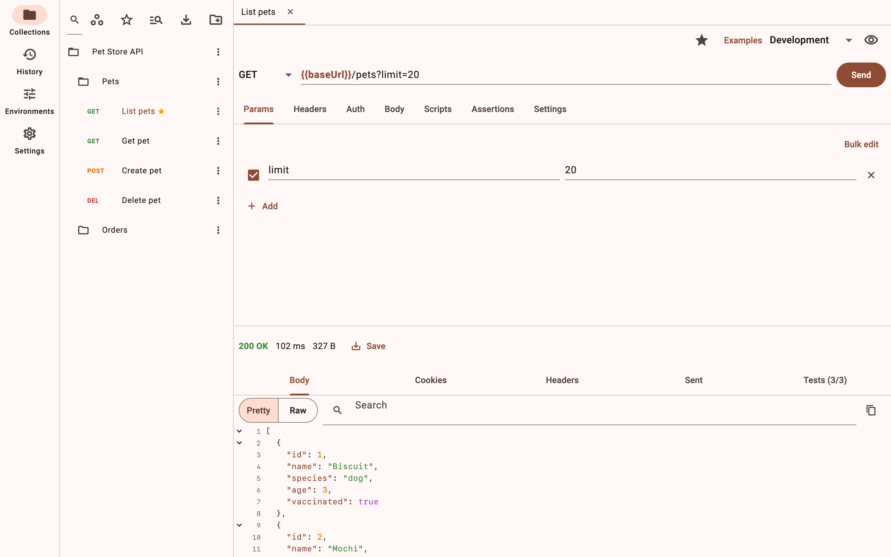
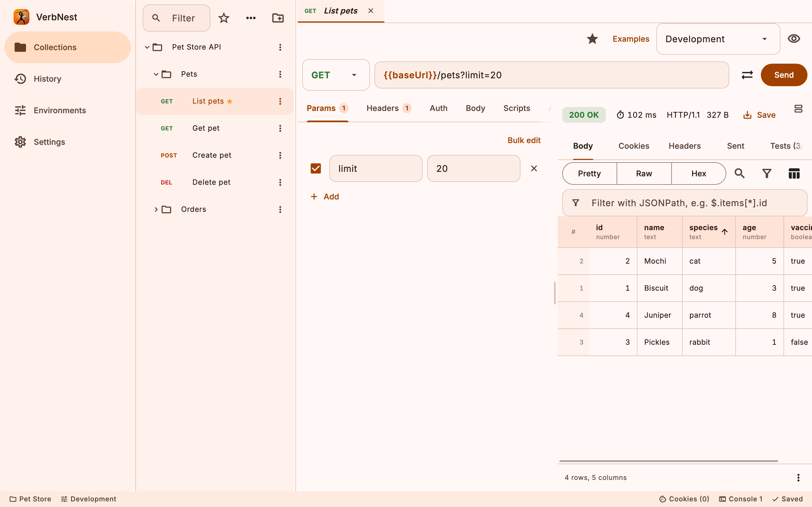

# VerbNest

A local-first API client for **macOS, Windows, Linux, Android and iOS**: compose, send, organise, script and test HTTP/REST, GraphQL, WebSocket and server-sent-event requests. No account, no cloud, no telemetry. Your collections, environments and history live in one portable file on your own device.



## Features
- **Requests:** every HTTP method, query params, headers; JSON, form, multipart and binary bodies; GraphQL, WebSocket and SSE. Variables such as `{{baseUrl}}` resolve from globals, environments, collections and folders; secret values stay on your device.
- **Organise:** collections, folders, tabs, favourites, workspace search, a command palette, saved response examples, undo for deletes and moves.
- **Auth:** Basic, Bearer, API key, JWT and OAuth 2.0 set once on a collection or folder and inherited.
- **Script and test:** pre-request and post-response JavaScript with a `pm`-style API, no-code assertions on status, headers, body and timing, and a collection runner.
- **Responses:** pretty, raw, hex and a **table view** that turns a list of results into a grid you can sort, search, copy and save as CSV; JSONPath filtering, headers, cookies, the exact request sent, timings, history and a network console.
- **Bring work in and out:** import Postman collections and environments, cURL, OpenAPI and HAR; generate cURL and other snippets; export a readable workspace snapshot of plain files you can keep in Git.
- **Real networks:** proxy support, custom CA and client certificates, a cookie jar; certificate checks are on by default.
- **Everywhere:** phones and tablets as well as desktops, light and dark themes, keyboard shortcuts, larger text sizes. English only, and no animations by design.



## Install
- **Downloads** (Windows installer, Linux packages): [VerbNest-releases](https://github.com/Omni-Technical-Solutions/VerbNest-releases/releases).
- **Windows:** `winget install Omni.VerbNest` once the package is accepted.
- **App stores:** the macOS, Android and iOS store builds are produced from this repository by Omni Technical Solutions.

## Build from source
You need the Flutter stable SDK (the Dart constraint is in [pubspec.yaml](pubspec.yaml)) and a Rust toolchain (`rustup`), which builds the embedded JavaScript engine.

```sh
git clone https://github.com/Omni-Technical-Solutions/VerbNest.git
cd VerbNest
flutter pub get
cd apps/verbnest_app
flutter run -d macos      # or windows, linux, or a connected Android or iOS device
```

Run the tests with `flutter test --exclude-tags golden` (see [CONTRIBUTING.md](CONTRIBUTING.md) for the full set of checks). Release builds are made with `scripts/` (macOS, Windows, Linux) and `flutter build ipa|appbundle`; signing identities are yours to set.

## How it is organised
| Folder | What it is |
| --- | --- |
| `apps/verbnest_app` | The Flutter app (all platforms) |
| `packages/verbnest_core` | Models, variables, assertions, result tables |
| `packages/verbnest_http` | The HTTP engine (HTTP/1.1, HTTP/2, WebSocket, SSE, auth) |
| `packages/verbnest_storage` | The SQLite workspace file and the secret store |
| `packages/verbnest_import` | Postman, cURL, OpenAPI and HAR import, code generation |
| `packages/verbnest_runner`, `verbnest_script` | The collection runner and the JavaScript engine |
| `packages/verbnest_cli` | The command line runner |
| `docs/spec`, `docs/adr` | Requirements, architecture and decision records ([index](docs/spec/README.md)) |

## Contributing
Bug reports, fixes and focused features are welcome: read [CONTRIBUTING.md](CONTRIBUTING.md) (commits are signed off under the [DCO](https://developercertificate.org/)) and the [Code of Conduct](CODE_OF_CONDUCT.md). Report security problems as described in [SECURITY.md](SECURITY.md).

## Licence
VerbNest is licensed under the [Apache License, Version 2.0](LICENSE); see also [NOTICE](NOTICE) and [THIRD_PARTY_NOTICES.md](THIRD_PARTY_NOTICES.md). Versions up to 0.64.3 were published under the Boost Software License 1.0 and stay available under it.

The licence covers the code and documentation. The names "VerbNest" and "Omni" and the VerbNest icon are not licensed for use by forks; see [TRADEMARK.md](TRADEMARK.md).
